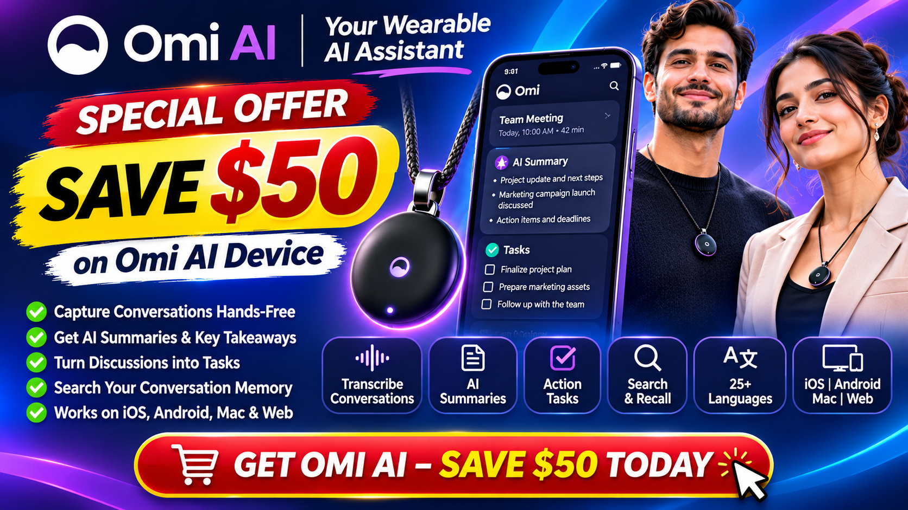

# 🧠 Omi AI Promo Code – Save $50 on Your Personal AI Assistant (2026)

---

  **Want to remember every important conversation without taking notes?**
   
  Discover Omi, a wearable AI assistant that captures conversations, creates summaries, organizes tasks, and helps you recall important information whenever you need it.

  🎉 **<a href="https://deal.ink/OmiAI">GET OMI AI – SAVE $50 ON YOUR PURCHASE</a>**

---

## 📑 Table of Contents

1. [What Is Omi AI?](#what-is-omi-ai)
2. [How Does Omi Work?](#how-does-omi-work)
3. [Omi AI Features](#omi-ai-features)
4. [Who Should Use Omi AI?](#who-should-use-omi-ai)
5. [Practical Ways to Use Omi AI](#practical-ways-to-use-omi-ai)
6. [Omi AI Pricing and Plans](#omi-ai-pricing-and-plans)
7. [Is Omi AI Worth Buying?](#is-omi-ai-worth-buying)
8. [Privacy and Security Considerations](#privacy-and-security-considerations)
9. [Frequently Asked Questions](#frequently-asked-questions)
10. [Get $50 OFF Omi AI](#get-50-off-omi-ai)
11. [Final Verdict](#final-verdict)
12. [Affiliate Disclosure](#affiliate-disclosure)

---

## What Is Omi AI?

Omi is a wearable AI assistant designed to help you remember conversations, organize information, and turn discussions into useful actions.

Think about how many important details you hear during a normal day:

- Instructions from your manager
- Discussions during business meetings
- Ideas that come to you while working
- Important details from client conversations
- Information shared during lectures
- Tasks and commitments discussed with colleagues
- Ideas you don't want to forget

Most people try to remember everything or write notes while talking. Unfortunately, important details can easily get lost.

Omi aims to solve this problem.

It is a small wearable AI device that captures conversations and works with the Omi app to turn speech into transcripts, summaries, tasks, and searchable memories.

Instead of constantly typing notes, you can focus on the conversation and review the important information afterward.

Omi can be worn using its included chain or wristband, or placed on a table during a conversation.

**Want to explore Omi and its current promotional offer?**

👉 [Check Out Omi AI – Save $50](https://deal.ink/OmiAI)

---

## How Does Omi Work?

Omi combines a wearable device, a mobile application, and AI-powered software.

The process is designed to be simple.

### Step 1: Get Your Omi Device

Purchase the Omi wearable device and receive the included accessories.

The package is advertised to include:

- Omi AI device
- Silicone case
- Neck chain
- Wristband
- Magnetic USB-C charging cable
- Quick-start guide

Check the current product listing to confirm the package contents.

### Step 2: Connect It to Your Phone

Pair the device with the Omi app on your compatible smartphone.

Omi supports iOS and Android, with additional Mac and web access.

### Step 3: Capture Conversations

Wear Omi around your neck, attach it to the wristband, or place it on a table.

The device uses its microphones to capture conversations. It can also record offline and synchronize information when connectivity becomes available again.

### Step 4: Get AI Summaries and Tasks

After conversations, Omi can turn recorded speech into useful information, including:

- Conversation transcripts
- Meeting summaries
- Important points
- To-do lists
- Action items
- Searchable memories

### Step 5: Search and Recall Information

You can use the Omi app to search previous conversations and ask questions about information you have captured.

For example:

- What did my manager ask me to complete?
- What was the deadline discussed during yesterday's meeting?
- What did the client say about the project?
- What were the main points from my last lecture?

This makes it easier to retrieve information without searching through pages of handwritten notes.

---

## Omi AI Features

Omi offers several features designed to make everyday conversations more useful.

### 1. Hands-Free Conversation Capture

One of Omi's main features is its ability to capture conversations without requiring you to manually start typing notes.

You can wear the device during meetings, discussions, and other situations where recording is appropriate.

This can help you stay focused on the conversation instead of constantly looking at your phone.

### 2. Automatic AI Summaries

Long conversations can contain a lot of unnecessary details.

Omi can generate summaries that help you understand the important points without reviewing an entire transcript.

This is particularly useful for meetings, interviews, lectures, and business discussions.

### 3. Automatic To-Do Lists and Action Items

Remembering what was discussed is useful, but remembering what you need to do next is even more important.

Omi can identify action items and turn them into organized tasks.

For example, after a meeting, you may have a list of things to:

- Send an email
- Contact a customer
- Complete a project
- Prepare a report
- Follow up with a colleague
- Review a document

### 4. Searchable Conversation Memory

Omi helps you search information captured from previous conversations.

Rather than manually reviewing multiple recordings, you can search for a topic or ask Omi a question about something you previously discussed.

This can be useful when you need to recall a particular instruction, decision, or important detail.

### 5. AI Questions and Answers

You can ask Omi questions about your captured information.

It acts like a personal memory assistant that helps retrieve details from your conversations.

The available question limits depend on your subscription plan.

### 6. Multilingual Transcription

Omi advertises support for more than 25 languages.

This can be useful for people who work, study, or communicate in multilingual environments.

Its speech features can also help identify different speakers through speech profiles.

Actual transcription quality can vary depending on language, accent, background noise, and recording conditions.

### 7. Offline Recording and Synchronization

Omi can record when an internet connection is unavailable and synchronize captured information later.

This can be helpful when travelling or working in locations with unreliable connectivity.

### 8. Daily Recaps and Memory Organization

Omi can help organize captured information into summaries and searchable memories.

Instead of having disconnected recordings, you can revisit important information from your day.

### 9. Integration With Other Applications

Omi supports integrations that can connect conversation information with other tools.

Depending on the available integrations and configuration, you can connect services related to:

- Calendar management
- Email
- Task management
- Note-taking
- AI assistants
- Automation workflows

The Omi ecosystem also supports connections with tools such as ChatGPT and Claude.

Check the current integration directory for supported applications and plan restrictions.

### 10. Wearable and Desktop Access

Omi is not limited to a wearable device.

Its ecosystem includes mobile applications, a Mac application, and web access.

This allows you to review and work with your captured information across supported devices.

### 11. Compact and Portable Design

The Omi device is designed to be small enough to wear throughout the day.

You can use the included chain or wristband, or simply place it on a table when appropriate.

### 12. Free Plan Included

Every Omi device includes access to a free software plan.

You can start using the core features without immediately paying for a recurring subscription.

Additional capabilities are available through the optional Pro plan.

---

## Who Should Use Omi AI?

Omi may be useful for people who regularly attend meetings, have important conversations, or need to remember large amounts of information.

Here are some examples.

### 1. Business Professionals

If you attend multiple meetings every week, remembering every discussion and commitment can become difficult.

Omi can help you capture important details, review meeting summaries, and organize follow-up tasks.

### 2. Entrepreneurs and Business Owners

Running a business involves conversations with employees, customers, suppliers, and business partners.

Omi may help entrepreneurs keep track of ideas, decisions, and commitments.

### 3. Students

Students often need to process a lot of information during lectures, discussions, and study sessions.

Omi can help create transcripts and summaries that make reviewing information easier.

Always follow your school's recording and academic policies.

### 4. Freelancers and Consultants

Freelancers and consultants frequently communicate with clients about requirements, deadlines, project changes, and feedback.

Omi can help organize those conversations and identify follow-up tasks.

### 5. Sales Professionals

Sales representatives have conversations with potential customers throughout the day.

Omi may help them remember customer requirements, questions, objections, and follow-up commitments.

### 6. Content Creators and Bloggers

Content creators often come up with ideas while talking to people, attending events, or working on projects.

Omi can help capture spoken ideas and turn them into searchable information.

### 7. Researchers and Interviewers

People who conduct interviews or research discussions may find transcription and searchable conversation records useful.

They should always obtain the necessary consent and follow applicable research and privacy requirements.

### 8. People Who Prefer Not to Take Notes

Some people find it difficult to listen carefully while writing notes at the same time.

Omi may help reduce that burden by capturing information for later review.

---

## Practical Ways to Use Omi AI

Here are some real-world examples of how Omi could fit into everyday work and personal activities.

### During Business Meetings

Wear Omi during an authorized meeting and review the summary afterward.

You can use the captured information to identify:

- Important decisions
- Assigned responsibilities
- Project deadlines
- Follow-up tasks
- Questions that still need answers

### During Client Conversations

If you work with clients, Omi may help you remember project requirements and important discussions.

For example, you could review what a client requested before preparing a proposal or sending a follow-up email.

### While Studying

Students can use Omi to help review lecture discussions and identify important topics.

It can also make it easier to search for a particular concept mentioned during a study session.

Always obtain permission before recording lectures where required.

### During Brainstorming Sessions

Ideas can appear unexpectedly.

You can use Omi to capture spoken thoughts and revisit them later instead of relying entirely on memory.

### For Daily Task Management

At the end of the day, review your captured information and identify tasks that still need attention.

This can help you organize your next day's priorities.

### For Personal Reminders

You can use Omi to recall details from conversations, such as recommendations, plans, and commitments.

Remember that Omi is a memory aid, not a replacement for important official records or critical reminders.

---

## Omi AI Pricing and Plans

Omi uses a combination of hardware pricing and optional software subscriptions.

The official offer page currently advertises the following device pricing in US dollars.

### Omi Device Pricing

| Purchase | Advertised Price | Savings |
|---|---:|---:|
| 1 Omi | $129 | $50 |
| 2 Omis | $218 | $160 total |
| 3 Omis | $297 | $270 total |

The regular listed device price is $179, with the promotional discount applied automatically at checkout.

Prices are in USD unless otherwise indicated. Your final payment may differ depending on currency conversion, shipping, taxes, and checkout location.

### Omi Free Plan

Every Omi device includes a free plan.

The official pricing information advertises:

- Unlimited on-phone transcription
- 300 cloud minutes per month
- Conversation summaries
- Tasks and memories
- Core Omi features

This means you can begin using Omi without immediately subscribing to a paid plan.

### Omi Pro Plan

The optional Pro subscription is advertised at:

- $29.99 per month
- $269.91 per year

Pro includes additional capabilities such as unlimited transcription, expanded AI question access, and other advanced features.

Check the current plan comparison because features and limits may change.

### Do You Need to Pay Monthly?

No. Purchasing the Omi hardware does not require you to immediately subscribe to Pro.

The free plan is included, and you can decide whether the optional paid subscription is worthwhile for your usage.

---

## Is Omi AI Worth Buying?

Whether Omi is worth buying depends on how often you need to capture conversations and retrieve information.

It may be particularly useful if you:

- Attend several meetings every week.
- Regularly speak with customers or clients.
- Need help remembering instructions and commitments.
- Prefer listening instead of taking handwritten notes.
- Want searchable conversation records.
- Frequently brainstorm ideas verbally.
- Need help turning discussions into tasks.

However, there are a few things to consider before purchasing.

### Consider Your Recording Needs

Omi is designed around capturing conversations. If you rarely attend meetings or don't need conversation summaries, you may not use the device enough to justify the purchase.

### Consider the Software Plan

The free plan includes useful features, but some advanced capabilities require Pro.

Review the plan limits to make sure they fit your needs.

### Consider Battery Life

The product listing advertises approximately 10–14 hours of battery life on a charge.

Actual battery performance can depend on usage and recording conditions.

### Consider Your Phone Compatibility

Omi supports iOS 15+, Android 7+, Mac, and web access according to its product information.

Check compatibility with your particular device before ordering.

### Consider Privacy and Consent

Because Omi captures conversations, you must consider the privacy expectations of other people.

Always obtain appropriate consent before recording conversations and follow applicable laws, workplace policies, and institutional rules.

---

## Privacy and Security Considerations

Privacy is particularly important for a device designed to capture conversations.

Omi advertises SOC 2 and HIPAA-related compliance claims, along with encryption in transit and at rest.

Its product information also describes options to export or delete captured data, and to run the software locally.

However, these claims should not be interpreted as automatic permission to record every conversation or as a guarantee that every use is compliant with privacy laws.

Before using Omi:

- Inform people when recording is taking place.
- Obtain consent where required.
- Follow your employer's recording and data-handling policies.
- Avoid recording confidential conversations without authorization.
- Be careful with medical, legal, financial, and other sensitive information.
- Review Omi's privacy policy and data-processing practices.
- Delete recordings that you no longer need.

If you work in a regulated environment, confirm that the product and your intended use meet the applicable requirements before recording sensitive information.

---

## Frequently Asked Questions

### 1. What is Omi AI?

Omi is a wearable AI assistant that captures conversations and turns them into transcripts, summaries, tasks, and searchable memories.

### 2. How does Omi work?

You wear or place the Omi device nearby and pair it with the Omi app. It captures conversations and processes them into useful information that you can review later.

### 3. Does Omi require a subscription?

No. Every Omi includes a free software plan. An optional Pro subscription is available for additional features and usage.

### 4. How much does Omi cost?

The official promotional page currently advertises one Omi device for $129 USD, reduced from $179 USD, representing a $50 saving.

The price and offer may change, so check the checkout page before purchasing.

### 5. Is Omi a one-time purchase?

The hardware is advertised as a one-time purchase. The optional Pro software plan is a recurring subscription.

### 6. Does Omi work with iPhone and Android?

Yes. Omi advertises compatibility with iOS 15+ and Android 7+, as well as Mac and web access.

Check the current compatibility information before ordering.

### 7. Can Omi record conversations automatically?

Omi is designed for hands-free conversation capture while worn and paired. Recording behaviour depends on the device and app settings.

Always follow consent requirements and applicable recording policies.

### 8. Can Omi summarize meetings?

Yes. Omi can generate summaries, identify important points, and create action items from captured conversations.

### 9. Does Omi support multiple languages?

Yes. Omi advertises support for more than 25 languages. Transcription quality may vary depending on the language and recording conditions.

### 10. Can I use Omi without an internet connection?

Omi advertises offline recording and synchronization when connectivity becomes available again.

Some processing and cloud features may require an internet connection.

### 11. How long does the Omi battery last?

The product listing advertises approximately 10–14 hours of battery life per charge. Actual performance may vary.

### 12. Can Omi connect with ChatGPT and Claude?

Omi advertises integrations with ChatGPT and Claude. Available functionality and access may depend on your configuration and subscription plan.

### 13. Is Omi suitable for students?

It may be useful for reviewing lectures, discussions, and study sessions. However, students should follow their institution's recording and academic policies.

### 14. Is Omi suitable for business meetings?

It may be useful for meeting summaries, action items, and retrieving information. Make sure all participants are informed and recording is authorized.

### 15. Does Omi offer a money-back guarantee?

The official product offer advertises a 30-day money-back guarantee. Review the current return policy and eligibility conditions before purchasing.

---

## Get $50 OFF Omi AI

If you regularly attend meetings, speak with clients, study, or work with large amounts of information, Omi may be worth exploring.

The device is designed to help you capture conversations, remember important details, and turn discussions into useful actions.

The current official promotional offer advertises $50 OFF the Omi device, with the discount applied automatically at checkout.

### Claim Your Omi AI Offer

🧠 **[GET OMI AI – SAVE $50 ON YOUR PURCHASE](https://deal.ink/OmiAI)**

Before completing your order, review the current device price, shipping charges, taxes, software plan details, warranty, and return policy.

---

## Final Verdict

Omi takes a different approach to productivity.

Instead of asking you to constantly write notes, it helps capture conversations and organize the information afterward.

For professionals, students, entrepreneurs, freelancers, consultants, and content creators, this could be a useful way to remember important discussions and reduce the time spent manually organizing notes.

Its combination of a wearable device, AI summaries, searchable memories, action items, multilingual support, and app integrations makes it an interesting tool for people who want a more organized way to manage everyday information.

The free plan is also a useful starting point because you don't have to commit to a recurring subscription immediately after purchasing the device.

However, it is important to consider battery life, software limits, device compatibility, and privacy requirements before buying.

If you think hands-free conversation capture could improve your daily workflow, explore Omi through the promotional link below.

🧠 **[EXPLORE OMI AI – CHECK THE $50 OFF OFFER](https://deal.ink/OmiAI)**

---

## Affiliate Disclosure

This article contains an affiliate link to Omi AI.

If you purchase through the link provided in this article, I may earn a commission or referral benefit at no additional cost to you.

The purpose of this guide is to help readers understand Omi's features, pricing, potential uses, and limitations before making a purchasing decision.

Product specifications, prices, software plans, discounts, and promotional offers may change. Always verify the latest information on the official Omi website before ordering.
